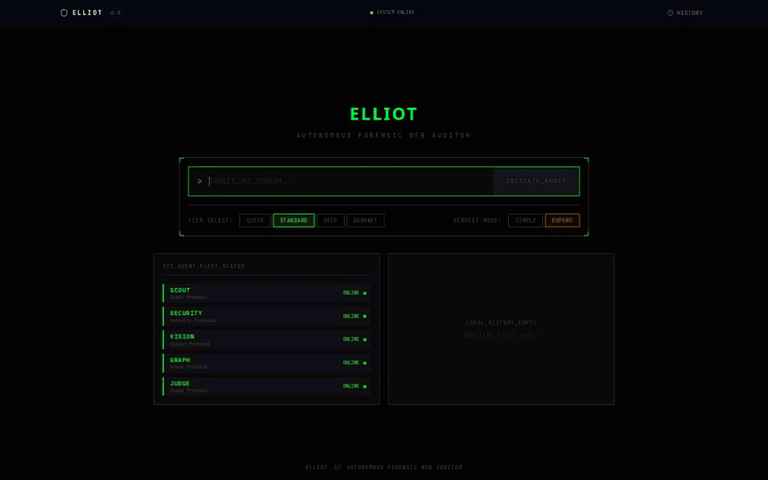
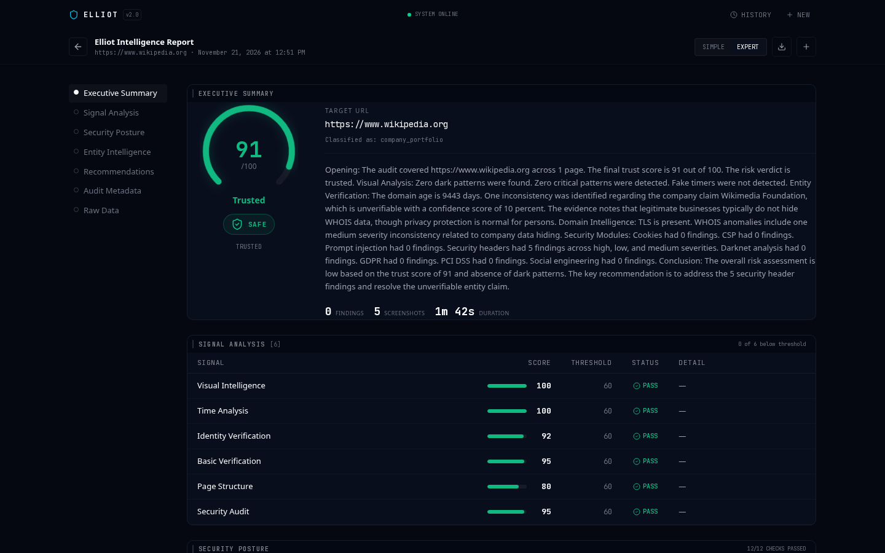
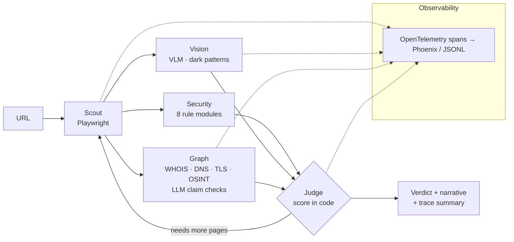
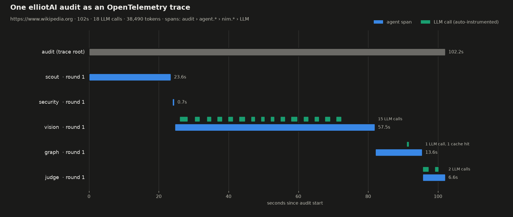
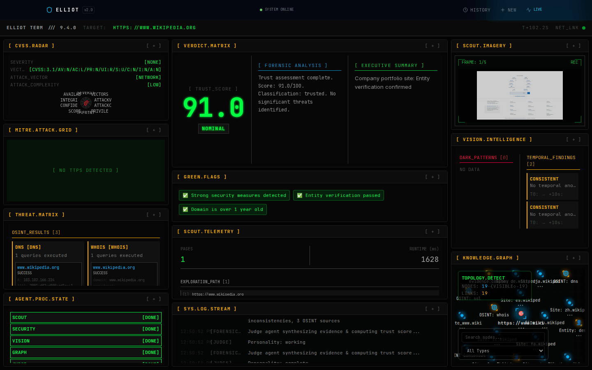
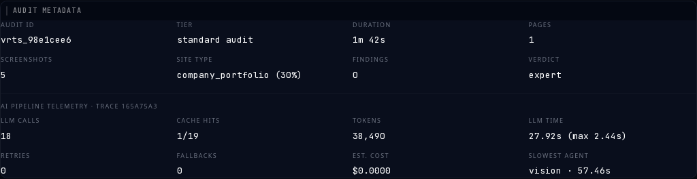
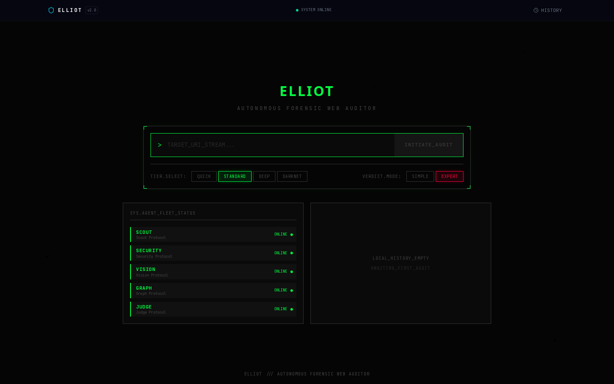

<h1 align="center">elliotAI</h1>

<p align="center">
  <strong>An agentic website-trust auditor: multimodal LLM agents browse a site, look at it, investigate who runs it, and return an evidence-backed trust score.</strong>
</p>

<p align="center">
  <a href="https://github.com/Jinish2170/elliotAI/actions/workflows/ci.yml"></a>
  
  
  
  <a href="LICENSE"></a>
</p>

<p align="center">
  <a href="https://elliotai.vercel.app"><strong>▶ Live demo: elliotai.vercel.app</strong></a>
</p>

<p align="center">
  
</p>

---

## What it does

Paste a URL. elliotAI runs a five-agent pipeline against the live site and explains its verdict:

- **Scout** drives a real browser (Playwright): screenshots at `t0` and `t+10s`, full page, sub-pages.
- **Security** runs 8 deterministic modules: headers, CSP, cookies, GDPR, PCI-DSS, social engineering, darknet indicators, prompt injection.
- **Vision** sends screenshots to a vision-language model to detect dark patterns (fake countdowns, confirm-shaming, pre-checked add-ons, fake badges, hidden unsubscribe).
- **Graph** checks who is behind the site (WHOIS, DNS, TLS, OSINT) and verifies the site's own claims with an LLM.
- **Judge** computes a 0–100 trust score **in code**, can send Scout back for more pages, and writes a grounded narrative.

<p align="center">
  
</p>

## Architecture



A **FastAPI** backend streams agent events over **WebSocket** to a **Next.js 16** UI. LLMs are served by **NVIDIA NIM** (OpenAI-compatible API) with model fallback, rate limiting, caching and a circuit breaker.

## AI engineering decisions

| Decision | Why | Where |
|---|---|---|
| **LLMs perceive, code decides** | The trust score is a deterministic function of six weighted signals plus override rules. It is unit-testable and explainable, and a hijacked model can corrupt one signal, not the verdict. | [`trust_weights.py`](elliot/config/trust_weights.py) |
| **Abstain instead of failing open** | With no evidence, the formula alone said 85, "probably safe". Below 25 % evidence coverage the system now answers `insufficient_evidence`. | `compute_trust_score` |
| **Structured outputs** | Taxonomy-derived Pydantic schemas, NIM constrained decoding (`json_schema`), and one repair retry with the validation error fed back. Every enum has an escape value: without one, the model labelled "Paris" a company. | [`structured.py`](elliot/core/structured.py) |
| **Tracing from day one** | One OpenTelemetry trace per audit (`audit › agent.* › nim.* › LLM`, OpenInference conventions), exported to Phoenix and JSONL. A per-audit token / latency / cost roll-up ships in the API and UI. | [`tracing.py`](elliot/core/tracing.py) |
| **Defence in depth against prompt injection** | Every audited page is attacker-controlled. Fields the detector flags never reach the LLM, the rest is fenced off (spotlighting), and an injection attempt *lowers* the score. | [`injection.py`](elliot/core/injection.py) |
| **Evals as a gate** | Deterministic policy checks run in CI; model-backed suites measure vision P/R/F1, attack success rate and end-to-end false alarms. | [`eval/`](eval/) |

## Results

Small, honest sets: these numbers are a baseline, not a benchmark claim.

| Eval | Result | Notes |
|---|---|---|
| Scoring policy (deterministic, CI gate) | **5 / 5** | was 2 / 5: fail-open, SSL cap, blocklist off-by-one |
| Vision dark-pattern detection (7 labelled pages, 5 categories) | **P 1.00 · R 0.80 · F1 0.89** | 0 false alarms; positives re-checked before scoring (was P 0.71 · 2 false alarms without it). Same result on 2 runs |
| Prompt-injection attack success rate | **1/3 → 0/3** | spotlighting alone left it at 1/3; quarantining flagged fields fixed it |
| End-to-end on real sites (wikipedia, example.com, 2 small businesses) | **0 / 4 false alarms** | standard audit 768 s → 293 s after concurrent vision (same site, same hour) |

Tracing found four pipeline bugs that 465 passing unit tests did not, including a vision agent that only ever looked at the homepage while the report claimed 8 pages. The full story, bug by bug: **[engineering case study](docs/ENGINEERING_CASE_STUDY.md)**.

<p align="center">
  
</p>

## Quick start

Requires Python 3.12, Node 20+, and an [NVIDIA NIM](https://build.nvidia.com) API key.

```bash
git clone https://github.com/Jinish2170/elliotAI.git && cd elliotAI
python -m venv .venv && . .venv/bin/activate
pip install -r requirements-dev.txt && python -m playwright install chromium
cp .env.example elliot/.env                     # then set NVIDIA_NIM_API_KEY

(cd backend && uvicorn main:app --port 8010) &  # API on :8010
cd frontend && npm install
NEXT_PUBLIC_API_URL=http://localhost:8010 NEXT_PUBLIC_WS_URL=ws://localhost:8010 npm run dev   # UI on :3000
```

Or from the CLI: `python -m elliot https://www.wikipedia.org --tier standard_audit`

### Evals and traces

```bash
python -m eval.run_eval --suite scoring      # deterministic, no API key needed
python -m eval.run_eval --suite vision       # VLM P/R/F1 per category
python -m eval.run_eval --suite injection    # attack success rate
python -m eval.run_eval --suite e2e          # real sites vs a domain-age baseline

PHOENIX_COLLECTOR_ENDPOINT=http://localhost:6006 python -m elliot <url>   # traces → Phoenix
```

Every audit also writes its spans to `elliot/data/traces/*.jsonl`.

## Screenshots

| Live audit | Telemetry from the trace |
|---|---|
|  |  |
| **Landing** | |
|  | |

## Deploy

Frontend on Vercel; backend in the repo's Docker image on any host with ~1 GB RAM per concurrent audit (measured). The live demo's backend is self-hosted behind a Cloudflare tunnel ([`deploy/local/`](deploy/local/README.md)). Public deployments get an SSRF guard, per-IP rate limits, a concurrency cap and a tier allowlist. See **[docs/DEPLOY.md](docs/DEPLOY.md)**.

## Limitations

- No phishing **recall** number yet: that needs a labelled set of live phishing captures.
- Eval sets are small, so confidence intervals are wide.
- Vision calls run one after another and take about 70 % of audit time; running them concurrently is the next optimisation.

## Documentation

| | |
|---|---|
| [Engineering case study](docs/ENGINEERING_CASE_STUDY.md) | Every bug: how it was found (trace, eval, test), root cause, fix, before and after |
| [Architecture](docs/architecture/ARCHITECTURE.md) | Components, data flow, conventions, stack |
| [Reference](docs/REFERENCE.md) | API, configuration, CLI, audit tiers, troubleshooting |
| [Deploy](docs/DEPLOY.md) · [User guide](docs/USER_GUIDE.md) · [Security policy](SECURITY.md) | |

## License

[MIT](LICENSE) © 2026 Jinish Kathiriya
